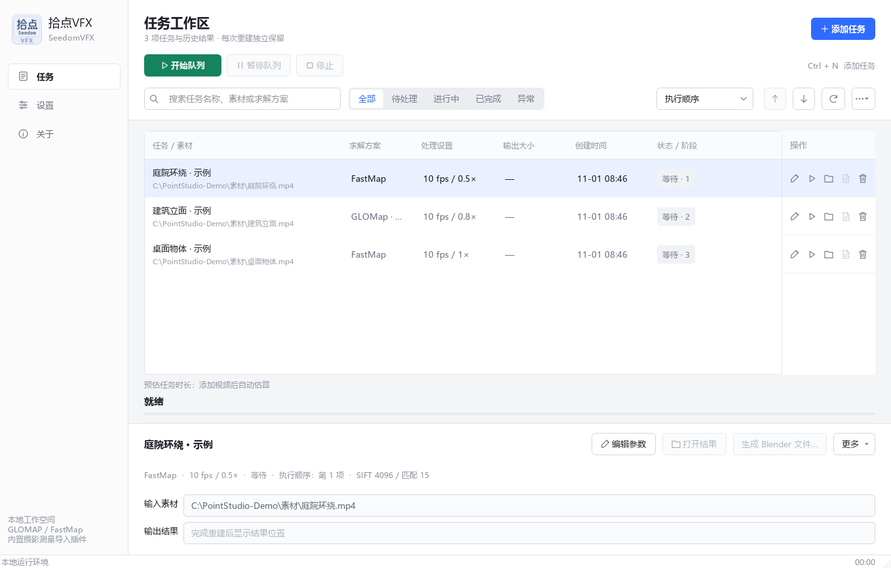

# 拾点 VFX · SeedomVFX

**把视频变成可在 Blender 中继续制作的相机运动与三维点云。**

拾点 VFX 是一款面向 Windows 的本地摄影测量桌面工具。导入拍摄的视频，选择重建方案并开始处理；软件会提取视频帧、估计相机运动并重建彩色点云，最后可将结果整理成 Blender 场景。

[](https://github.com/DingBuDoa/Seedom/releases)
[](#运行要求)
[](#)

**普通用户：**
前往 [GitHub Releases 下载 Windows 便携版](https://github.com/DingBuDoa/Seedom/releases)。本仓库的 **Code → Download ZIP** 是源码，不是可直接运行的安装包。

1.1.1 起支持在“设置 → 软件更新”检查 GitHub、下载热补丁并安装重启，可关闭启动自动检查。
1.1.0 用户需先手动安装 1.1.1 热补丁一次。个人设置、任务记录、耗时参考和项目文件保留；更新会备份被替换文件。
后续发布使用统一的 ZIP 热补丁和 `update.json`，见 [更新发布标准](UPDATE-STANDARD.md)。

## 软件界面



## 它能做什么

拍摄一段围绕物体或场景移动的视频后，拾点 VFX 可以把视频中的画面对应到三维空间：恢复拍摄相机在各帧的位置与朝向，并生成带颜色的稀疏点云。处理结果可以在项目列表中管理，也可以导入 Blender，作为相机动画和场景参考继续制作。

典型用途包括产品环绕展示、室内外场景记录、镜头运动参考、三维预览，以及为 Blender 合成或动画制作准备相机轨迹。重建结果是摄影测量数据和点云，不等同于自动生成的高精度封闭网格模型。

### 重建方案

| 方案 | 适合情况 | 说明 |
| --- | --- | --- |
| **FastMap** | 希望更快完成重建 | 使用 PyTorch CUDA 进行特征与匹配计算，并提供计算精度档位。 |
| **GLOMap** | 更看重全局相机运动解算 | 基于 COLMAP / GLOMap 流程；GPU 不可用时可按设置使用 CPU。 |

实际速度和结果取决于素材、拍摄路径、纹理、运动模糊、帧数与硬件。软件提供两种方案供选择，不保证每段视频都能成功重建。

### 主要功能

- 支持常见视频格式，可添加单个视频或批量建立处理队列。
- 设置抽帧率、处理分辨率、图像尺寸、匹配范围和相机模型。
- 查看排队、处理阶段、进度、预估时间与任务日志；可调整待处理任务顺序。
- 保存每个任务的设置和结果，查看已有项目，并在不重新解算的情况下再次导出 Blender 工程。
- 导出相机动画、彩色点云、背景序列和 `.blend` 场景；可控制点云显示、背景合成、帧率和起始帧偏移。
- 处理与项目数据保存在本机。应用不会要求上传视频到云端。

## 快速开始

1. 打开 [Releases 页面](https://github.com/DingBuDoa/Seedom/releases)，下载最新版本的 Windows 便携包并解压到本地目录。
2. 双击解压目录中的 `Start.bat`。发行包自带应用运行所需的 Python、界面组件及求解运行文件，不需要单独安装 Python 或 CUDA Toolkit。
3. 点击“添加任务”，选择视频并设置求解方案、输出位置和处理参数。第一次使用时可先保留默认值。
4. 点击“开始队列”运行任务。处理完成后，在项目详情中打开结果，或选择 Blender 导出。

导出 `.blend` 文件需要另外安装 **Blender 4.0 或更新版本**。软件会扫描本机 Blender；也可以在任务设置中添加其他 Blender 可执行文件。

## 推荐素材与处理流程

### 拍摄建议

- 围绕场景平稳移动，尽量让相邻画面有足够重叠；避免只拍摄大幅度、快速摇移的镜头。
- 让画面包含清晰、稳定且有纹理的细节。纯色墙面、反光表面、重复纹理、快速运动和严重模糊都会增加重建难度。
- 尽量保持曝光、焦距和对焦稳定。环绕物体拍摄时，确保物体从多个方向都能被看到。
- 视频越长、抽取帧越多，处理时间、内存与显存占用通常越高。可先用较低处理分辨率或较少帧数测试素材。

### 从视频到 Blender

1. **添加素材：**创建任务并选择视频文件。批量任务会按队列顺序执行，可在开始前调整顺序。
2. **选择求解器：**先尝试 FastMap 进行快速重建；需要另一种全局解算路径时选择 GLOMap。
3. **检查处理设置：**抽帧率为 `0` 时按软件默认策略取帧；可调整处理分辨率和最大图像尺寸以平衡时间与资源占用。
4. **运行并查看结果：**任务完成后检查相机与点云。如果素材路径失效，任务会报错并跳过，后续队列仍可继续。
5. **生成 Blender 文件：**启用 Blender 导出并选择本机版本。也可以先完成求解，再从已有项目手动导出。

**起始帧偏移的含义：**偏移 `N` 会让 Blender 中的相机轨迹和背景从第 `N+1` 帧开始，关键帧仍然逐帧连续。它只影响 Blender 时间轴，不会减少视频解算帧数或导出序列帧数量。

## 输出文件

默认输出位于应用目录下的 `output/`。每个任务有独立项目目录，名称重复时会自动添加序号。

```text
output/
└── 项目名称/
    ├── point could/           点云与 COLMAP 模型文件
    ├── log/                   任务日志
    ├── video/                 可选导出的 JPG 序列帧
    ├── 项目名称_4.2.blend     Blender 场景（示例文件名）
    └── _cache/                数据库、处理帧与背景素材
```

Blender 场景的背景会引用项目缓存中的图像。**移动或分享 `.blend` 文件时，请同时保留整个项目目录，尤其是 `_cache/`。**已有 Blender 文件不会被静默覆盖。

## 运行要求

- **操作系统：** Windows 10/11 x64。
- **GPU 加速：** 需要兼容的 NVIDIA 显卡和正常工作的 NVIDIA 驱动；便携包包含所需 CUDA 运行时组件，不需要安装 CUDA Toolkit。显卡显存需求与视频长度、分辨率和匹配规模有关，无法对所有素材给出统一的最低值。
- **Blender 导出：** Blender 4.0 或更新版本，需单独安装。只做重建不要求安装 Blender。
- **磁盘空间：** 视频帧、数据库、日志和项目缓存会占用额外空间，长视频或高分辨率素材尤其明显。

如果 GLOMap 因设备或驱动问题退回 CPU，计算会明显变慢；软件会记录或提示回退情况。FastMap 的长轨迹处理采用分块方式降低临时显存峰值，但大场景仍可能超出机器资源。

## 常见问题

**下载 ZIP 后为什么无法启动？**

GitHub 源码 ZIP 不包含 Python、Qt、CUDA 运行时、FFmpeg、COLMAP 或 GLOMap 等运行文件。普通用户请下载 Releases 中的完整便携发行包。

**必须安装 Blender 吗？**

不需要。视频重建可独立运行；只有生成或打开 `.blend` 场景时才需要安装 Blender。

**处理结果在哪里？**

默认在解压目录下的 `output/项目名称/`。输出根目录可以在软件设置中修改。

**可以只导出 Blender 工程而不重新计算吗？**

可以。选择已完成的项目后，从项目操作中再次导出即可。

**能否从源码直接运行或构建完整发行包？**

可以进行界面和应用代码开发，但仓库不包含完整的原生求解器与运行库。请阅读[开发说明](docs/DEVELOPMENT.md)了解环境准备、回归测试和发行构建步骤；仅安装 Python 包不足以复现完整便携版。

## 开发者

- [源码开发与发行构建](docs/DEVELOPMENT.md)
- [参与贡献](CONTRIBUTING.md)
- [行为准则](CODE_OF_CONDUCT.md)
- [安全政策](SECURITY.md)
- [更新记录](CHANGELOG.md)
- [1.1.0 发行说明](docs/RELEASE_v1.1.0.md)
- [第三方项目与许可](THIRD_PARTY_NOTICES.md)
- [所有发行版本](https://github.com/DingBuDoa/Seedom/releases)

本项目集成 FastMap、GLOMap、COLMAP、FFmpeg 和 Blender Photogrammetry Importer 等开源项目。各组件作者与许可信息见 [THIRD_PARTY_NOTICES.md](THIRD_PARTY_NOTICES.md) 及组件目录中的许可文件。
