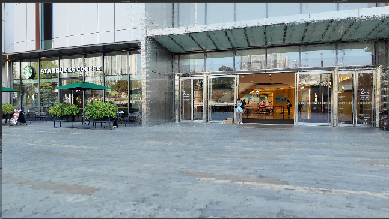
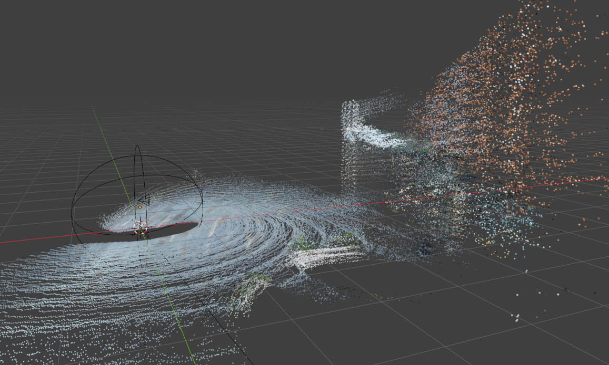
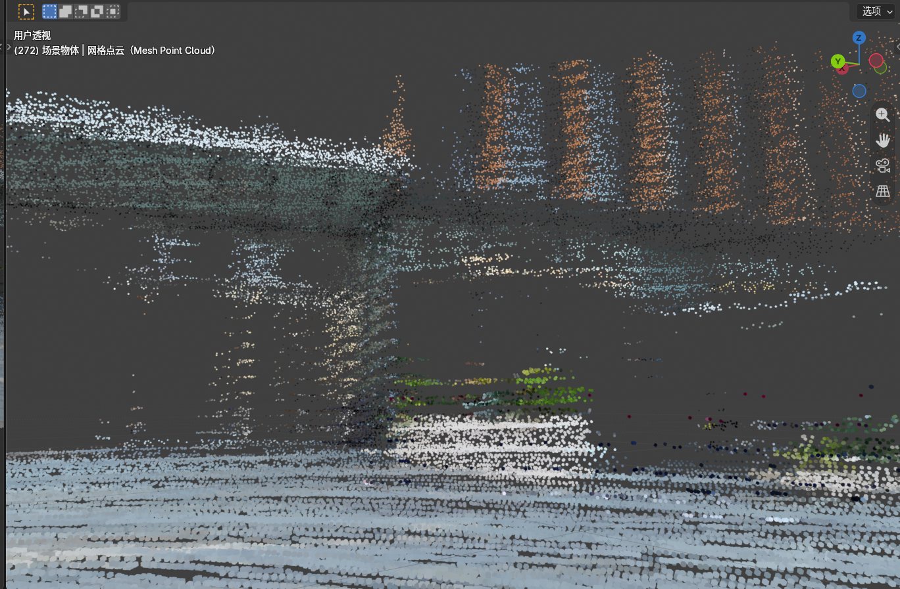
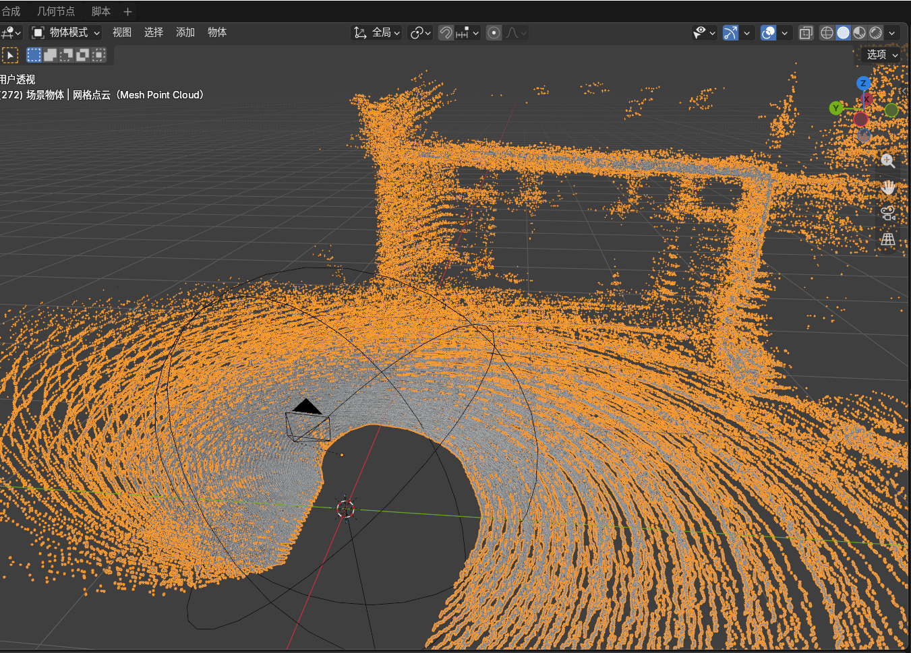
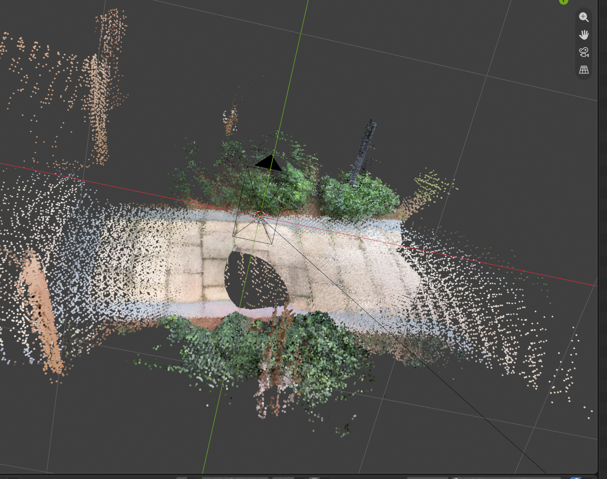

<div align="center">

# 拾点 VFX · SeedomVFX

### 从视频与图像序列，到 Blender 相机动画与彩色点云

面向 Windows 的本地重建工作台，将素材导入、相机估计、点云输出与 Blender 工程交付整合到同一工作流。

[](https://github.com/DingBuDoa/Seedom/tree/2.0.0-dev)
[](#运行环境)
[](#功能概览)
[](#两种重建方案)

[效果展示](#效果展示) · [功能概览](#功能概览) · [使用流程](#使用流程) · [开发环境](docs/DEVELOPMENT.md) · [模型配置](docs/VGGT-OMEGA.md)

</div>

> **当前分支：`2.0.0-dev`，开发预览。** 默认采用 VGGT-Omega，保留旧版 GLOMAP 几何重建流程。此分支源码不等于已发布的 Windows 便携版，也不包含模型权重和运行库。1.X 代码继续保留在 [1.x-maintenance](https://github.com/DingBuDoa/Seedom/tree/1.x-maintenance)，历史发行包见 [Releases](https://github.com/DingBuDoa/Seedom/releases)。

## 项目定位

拾点 VFX 将拍摄素材转换为可供三维制作继续使用的相机与场景参考：导入视频或图像序列，在本地完成相机和点云重建，再按需生成 Blender 工程。

2.0 的主要变化是引入 **VGGT-Omega 神经重建路径**。模型直接预测每帧的相机外参、内参与场景深度，省去该路径中的 SIFT 提取和特征匹配；已有 **GLOMAP 路径**继续提供基于特征对应与多视图几何的重建方式。两种方案共用任务队列、项目结构和 Blender 导出流程。

适合研究与试验相机匹配、场景布局、点云可视化和 Blender 合成工作流。输出是相机与点云参考，**不包含自动生成的封闭网格、UV、纹理贴图或具有真实单位的测量模型**。VGGT 路径适用非商业研究许可，详见[许可与致谢](#许可与致谢)。

## 效果展示

以下图片由项目作者提供，展示 Blender 中的相机视图、彩色点云和相机空间关系。它们是特定素材的视觉示例，不是精度基准，也不代表所有输入都能得到相同结果。

### 场景 A · 相机视图与场景点云



*相机视图示例。背景素材用于检查画面与轨迹，画面中的实景细节不应理解为已生成带纹理网格。*

<table>
  <tr>
    <td width="50%"></td>
    <td width="50%"></td>
  </tr>
  <tr>
    <td align="center">彩色点云与相机的空间关系</td>
    <td align="center">地面与建筑细节的点云表示</td>
  </tr>
</table>

<details>
<summary>查看点云选中状态与相机分布</summary>



橙色来自 Blender 的对象选中状态，用于展示点云分布。

</details>

### 场景 B · 室外地面与植被



*从其他视角检查点云的空间结构。预测深度可能存在噪声、空洞和局部形变，应结合原素材检查。*

## 功能概览

| 环节 | 当前功能 |
| --- | --- |
| 素材输入 | 视频文件、图像序列；视频预览、处理帧率选择；图像序列跳过视频拆帧。 |
| 重建设置 | 手动选择 VGGT-Omega / GLOMAP、CPU / GPU 开关，在全局设置中指定 GPU。 |
| 任务管理 | 多任务队列、优先级调整、状态筛选、任务日志、阶段进度与剩余时间估计。 |
| 项目管理 | 按项目保存参数、结果与日志；在已有结果上再次导出 Blender，无需重新解算。 |
| 模型输出 | 彩色 PLY 点云、COLMAP BIN / TXT 相机与点云模型、结果摘要。 |
| Blender 导出 | 相机动画、逐帧焦距、点云、可选背景序列与合成节点、起始帧偏移。 |
| 背景序列 | JPG、PNG、无损 WebP、TIFF；原尺寸、比例缩放和按高度限制尺寸。 |
| 桌面体验 | 简体中文界面，自动 / 浅色 / 深色主题，Blender 版本检测与手动添加。 |
| 队列完成动作 | 可选完成后关机或休眠，动作类型在设置中选择。 |

界面按求解器显示相关参数：VGGT 使用推理档位控制模型输入尺寸与批次，GLOMAP 保留处理分辨率、计算精度和几何重建参数。剩余时间为估计值，缺少有效进度或历史参考时不保证能够给出可靠数值。

## 两种重建方案

| | VGGT-Omega · 默认 | GLOMAP · 传统几何路径 |
| --- | --- | --- |
| 核心方法 | 神经模型预测相机、逐帧内参与深度，再将深度反投影为点云。 | 配套 COLMAP 工具提取、匹配特征，由独立 GLOMAP 进行全局几何重建。 |
| 点云含义 | 经置信度筛选的单视图预测深度采样点。 | 来自多视图特征轨迹的稀疏三角化点。 |
| 使用场景 | 快速探索相机与场景结构，研究神经重建和 Blender 工作流。 | 画面有清晰纹理、相机有足够平移与多视图重叠的素材。 |
| 资源控制 | 分批推理、显存检测、OOM 缩小批次重试；支持显式 CPU 模式。 | 根据原生构建、阶段、问题规模和设置使用 CPU / GPU。 |
| 焦距处理 | 模型预测每帧内参，不调用旧版分段焦距脚本。 | 标准几何流程；另保留实验性连续变焦分段焦距选项。 |
| 主要限制 | 长序列依赖局部批次连接，目前没有全局 BA 或回环优化。 | 低视差、纯旋转、弱纹理与不可靠匹配可能导致退化或失败。 |

软件不会把 VGGT 失败任务静默改用其他求解器。开启 GPU 也不代表每一步都在显卡上执行；视频处理、数据准备、部分几何计算、文件输出仍可能使用 CPU。

**COLMAP 研究代码保留。** 此前的原生动态焦距 BA、自定义 C++ 平滑约束和诊断工作已归档；新任务界面不再将新版 COLMAP Global Mapper 列为独立选项。GLOMAP 所需的 COLMAP 特征与匹配工具仍然使用。详见 [COLMAP 研究归档](docs/COLMAP-RESEARCH-ARCHIVE.md)。

## 使用流程

### 1. 准备运行环境

当前 2.0 分支面向开发与预览测试。首次使用源码时，先按[开发说明](docs/DEVELOPMENT.md)准备 Python / Qt、FFmpeg、求解器及模型。**直接下载源码 ZIP 无法获得完整运行环境**，已有 1.X 便携包也不会自动包含 VGGT-Omega。

已有完整开发工作区时可通过 `Start-Dev.bat` 启动；独立目录需要准备 `runtime/` 后使用 `Start.bat`。不要把 2.0 源码当作通用热补丁直接覆盖 1.X 发行包。

### 2. 添加素材与选择方案

1. 点击“添加任务”，选择视频或图像序列目录并填写项目名称。
2. 选择 VGGT-Omega 或 GLOMAP，并按硬件情况启用 CPU / GPU。
3. 视频可调整处理帧率；VGGT 选择推理档位，GLOMAP 按需调整处理分辨率与计算精度。
4. 按需启用 Blender 导出，选择本机 Blender 版本、序列格式、尺寸和时间轴参数。
5. 开始队列，通过阶段进度、日志与导出结果检查任务。

图像序列按文件名自然排序；VGGT 输入需具有一致画面比例，至少包含三张图像。视频处理帧率决定实际参与推理的帧数；每张输入图像均参与模型预测，不用插值冒充预测结果。

### 3. 检查与继续制作

成功后打开项目目录，检查相机运动、焦距变化与点云结构。任务阶段显示完成并不等于轨迹已通过真实场景精度验证。需要其他 Blender 版本或不同背景规格时，可从已有项目再次导出。

**起始帧偏移：**设为 `30` 时，相机运动数据及对应背景从 Blender 第 `31` 帧开始；不会每隔 30 帧才写一个关键帧，也不会减少解算帧数。

## Blender 与输出结构

```text
output/
└── 项目名称/
    ├── point could/              # 模型、彩色点云与求解报告
    │   ├── cameras.bin / .txt
    │   ├── images.bin / .txt
    │   ├── points3D.bin / .txt
    │   └── …
    ├── log/                      # 当前项目的处理与导出日志
    ├── video/                    # 可选 Blender 背景序列，按格式与尺寸分开保存
    ├── 项目名称_4.2.blend        # 示例：按选定 Blender 版本生成
    └── _cache/                   # 轻量项目记录；计算期间也保存重型中间文件
```

- **背景序列属于 Blender 导出。** 不导出 Blender 时无需额外生成交付序列。
- **格式：**JPG、PNG、无损 WebP、TIFF。
- **尺寸：**原尺寸、1/2、1/4、1/8，或最高 2160p、1440p、1080p、720p、480p；保持宽高比，不放大原素材。
- **计算缓存：**新任务在求解及所需导出全部成功后，清理应用拥有的重型计算缓存，保留轻量项目记录。失败、取消或导出失败会保留缓存；不扫描删除历史工程缓存，也不删除原素材。
- **再次导出：**已有相同规格的完整背景序列可复用；生成其他规格需要原视频或原图像序列。原素材不可用时，可关闭背景与序列，仅导出相机和点云。
- **项目命名：**新建任务会检查名称冲突并在窗口内提示；输出目录另有防覆盖保护。失败任务目录复用为可选设置，不覆盖已完成项目。

分享或移动 `.blend` 时，应同时保留它引用的 `video/` 目录。历史文件若仍引用 `_cache/images`，需要保留旧素材路径。逐帧焦距可导出，但 Blender 渲染像素宽高比不可动画，因此部分内参变化会产生近似；原始内参和相关误差诊断保存在工程与导出报告中。

## 运行环境

| 项目 | 说明 |
| --- | --- |
| 系统 | 主要开发与验证平台为 Windows 10 / 11 x64。 |
| 界面 | Python 3.13.11、PySide6 / Qt；具体依赖见 `config/runtime-requirements.txt`。 |
| VGGT 推理 | 当前验证环境为 PyTorch 2.9.1+cu130、NumPy 2.3.5、Pillow。需要单独配置官方模型源码与本地权重。 |
| NVIDIA GPU | 需要与所用 PyTorch / 原生求解器运行时兼容的驱动；模型推理本身不要求 nvcc 或重新编译 C++。 |
| CPU | 可显式选择 CPU 推理；1B 模型在 CPU 上可能明显较慢。 |
| Blender | 导出需要另行安装 Blender；本地已验证 4.2 LTS 与 5.2 预览构建，不代表所有版本均已验证。 |
| 存储 | 权重约 4.58 GB，此外需为运行库、抽帧缓存、背景序列和结果预留空间。 |

### VGGT 推理档位与 8GB 显存

| 档位 | 模型输入最长边 | 每批帧数上限 |
| --- | ---: | ---: |
| 低 | 384 | 8 |
| 中 | 512 | 12 |
| 高 | 512 | 20 |

上表是本适配的资源配置，不是准确率等级或通用显存保证。模型对当前批次的上下文敏感，改变档位也可能改变结果。

工作进程检查**设置中选中显卡的当前可用显存**。不足 8 GiB 时限制到不高于低档配置；不足 5.5 GiB 时提前提示。推理发生 OOM 时尝试缩小批次，首批必要时降低输入尺寸；无法继续则报错，不会静默切换 CPU。8GB 显卡需留出其他程序和桌面的显存余量，不能据此保证所有素材都能处理。

VGGT 不显示 GLOMAP 的处理分辨率参数：视频先按源尺寸拆帧，再由推理档位控制模型输入。**处理帧率仍然有效**；Blender 背景序列的导出尺寸则独立控制。

## 当前验证与已知限制

本分支仍在开发，视觉示例与局部通过的测试不能替代真实轨迹验证。

- **已验证的流程：**本地 CUDA / CPU 推理、视频和图像序列输入、标准模型读取、Blender 导出，以及缓存清理后的背景引用。单 GPU 主机上测试过 GPU 索引传递，尚未进行多物理 GPU 实测。
- **已完成的一段长片测试：**405 帧素材在 RTX 4070 SUPER 上完成推理与模型输出，模型读取验证通过；没有真实轨迹作为精度基准，不应据此推导所有素材的成功率或耗时。
- **长视频仍有漂移风险：**当前采用重叠批次连接，没有全局 BA、回环优化或自动独立镜头重建。批次预测存在差异时，可能累计尺度、位置或朝向误差。
- **快速变焦问题尚未解决：**一段 446 帧素材在批次连接时失败；扩大重叠、参考帧重试以及降低到 10 fps 均未完成全片。当前保留一致性检查，无法可靠连接时停止，不将未完成结果标为成功。
- **深度点云不是三角化真值：**VGGT 点云为相对尺度的预测深度采样；当前全项目最多输出 250,000 个采样点，每帧最多 2,000 个。这是输出体积限制，不表示测量精度。
- **困难素材需要逐段检查：**切镜、纯旋转、低视差、动态主体、模糊、镜面及大面积无纹理区域都可能影响结果。实验性变焦选项也不保证恢复稳定轨迹。

详细环境、测试范围与失败记录见 [VGGT 使用说明](docs/VGGT-OMEGA.md) 和 [验证记录](docs/VGGT-VALIDATION.json)。报告问题时请附所用分支 / 提交、求解器、处理参数、CPU / GPU 与显存、相关项目日志及可复现步骤；可以通过 [Issues](https://github.com/DingBuDoa/Seedom/issues) 提交。

## 源码与分支

```text
app/                       桌面界面、任务调度、重建适配与 Blender 导出
photogrammetry_importer/    本地适配的 Blender 摄影测量导入代码
config/runtime-*           依赖索引，不含个人配置与模型
docs/                      使用说明、验证记录、许可与展示图片
tests/                     回归测试；生成素材与测试结果不进入 Git
tools/                     打包、校验与维护脚本
runtime/                   本地运行库位置，二进制不进入 Git
```

| 分支 | 用途 |
| --- | --- |
| [`2.0.0-dev`](https://github.com/DingBuDoa/Seedom/tree/2.0.0-dev) | 当前 2.0 应用开发：VGGT-Omega + GLOMAP。 |
| [`1.x-maintenance`](https://github.com/DingBuDoa/Seedom/tree/1.x-maintenance) | 1.X 维护源码，保留旧版工作流。 |
| [`backup/seedom-2.0-colmap-global-20261115`](https://github.com/DingBuDoa/Seedom/tree/backup/seedom-2.0-colmap-global-20261115) | 之前的 COLMAP Global Mapper 应用适配快照。 |
| [`backup/colmap-v2.0.0-dynamic-focal-20261115`](https://github.com/DingBuDoa/Seedom/tree/backup/colmap-v2.0.0-dynamic-focal-20261115) | COLMAP 底层动态焦距研究快照，与应用源码分开保存。 |

源码、模型、原生二进制和用户项目分别管理。本分支更新不代表修改 1.X 发行包，也不代表发布了 2.0 正式版。

## 许可与致谢

Seedom 自身源码的许可见 [LICENSE](LICENSE)。第三方组件保留各自许可，Seedom 的许可不会替代它们。

| 项目 | 用途 | 来源 |
| --- | --- | --- |
| VGGT-Omega | 主要相机、内参与深度预测模型 | [facebookresearch/vggt-omega](https://github.com/facebookresearch/vggt-omega) |
| GLOMAP | 传统全局几何重建 | [colmap/glomap](https://github.com/colmap/glomap) |
| COLMAP | 特征提取、匹配、模型工具及归档研究 | [colmap/colmap](https://github.com/colmap/colmap) |
| Blender Photogrammetry Importer | Blender 摄影测量数据导入 | [SBCV/Blender-Addon-Photogrammetry-Importer](https://github.com/SBCV/Blender-Addon-Photogrammetry-Importer) |
| FFmpeg | 视频解码、抽帧与背景序列转换 | [FFmpeg/FFmpeg](https://github.com/FFmpeg/FFmpeg) |
| PySide6 / Qt、PyTorch、Blender | 桌面界面、模型推理与三维制作 | [Qt for Python](https://www.qt.io/qt-for-python) · [PyTorch](https://pytorch.org/) · [Blender](https://www.blender.org/) |

**VGGT-Omega 适用 FAIR Noncommercial Research License。** 使用其源码、权重及适用输出时需遵守上游非商业研究条款；Seedom 开放源码并不自动授予模型商业使用权或额外分发权。权重不纳入本仓库或普通热补丁。请从官方渠道取得模型并遵循相应许可。

更多版本与许可说明见 [THIRD_PARTY_NOTICES.md](THIRD_PARTY_NOTICES.md) 和 [VGGT-Omega 许可原文](docs/licenses/VGGT-Omega-LICENSE.txt)。感谢各上游项目的作者与贡献者。

---

[开发与环境配置](docs/DEVELOPMENT.md) · [参与贡献](CONTRIBUTING.md) · [安全政策](SECURITY.md) · [历史发行](https://github.com/DingBuDoa/Seedom/releases)
